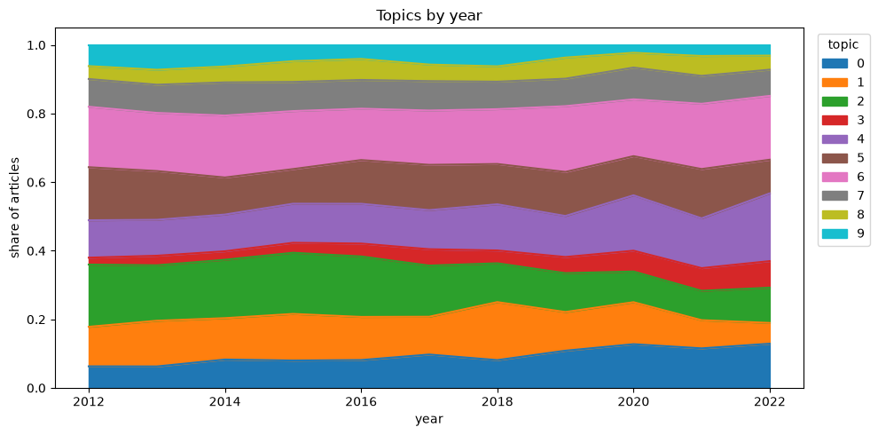

# Que tematicas aborda, en que proporcion y como ha cambiado a lo largo de los años

Por medio de una matrix de frecuencia de terminos y documentos TF-IDF, se identificaron 10 grupos de terminos que suelen aparecer juntos (por medio de una factorizacion NMF), sin contar los terminos raros y los que son comunes a mas del 50% de los articulos.

Aqui se muestran los 10 terminos mas frecuentes en cada topico:

1. *Universitario* unidad, unidad regional, regional, urs, campus, sur, navojoa, ciencias, regional sur, división
2. *Artistico* música, obra, teatro, artes, danza, historia, festival, concierto, musical, presentar
3. *Equidad de genero* mujer, género, violencia, hombre, equidad, igualdad, violencia género, perspectiva género, social, perspectiva
4. *Salud y bienestar* salud, enfermedad, cáncer, persona, medicina, enfermería, médico, alimento, paciente, físico
5. *Rectoria* rector, institución, educación, universitario, superior, grijalva, grijalva monteverde, monteverde, educación superior, calidad
6. *Investigacion y desarrollo* investigación, ingeniería, ciencia, proyecto, científico, posgrado, tecnología, investigador, física, área
7. *Nuevo ingreso* examen, aspirante, curso, alumno, licenciatura, semestre, ingreso, inscripción, hora, evaluación
8. *Juridisprudencia* derecho, penal, justicia, sistema, mediación, jurídico, oral, derechos, sistema justicia, derechos humanos
9. *Deportivo* deporte, física, medalla, deportivo, atleta, equipo, universiada, nacional, olimpiada, premio
10. *Economico* economía, económico, méxico, social, país, gobierno, política, desarrollo, empresa, cambio

Estos varian levemente a lo largo de 10 años, como se ilustra en la siguiente figura (donde el 0 es el 10):

Como se ve la mayoria de los topicos se mantienen practicamente constantes, con ligeras aumentos en temas *salud y bienestar*, *economia* y *equidad de genero. Con la correspondiente dismunucion de* tema de la universidad y eventos *artisticos. Lo que claremente indica el cambio de prioridades que ha tomado el foco en los ultimos años.*
